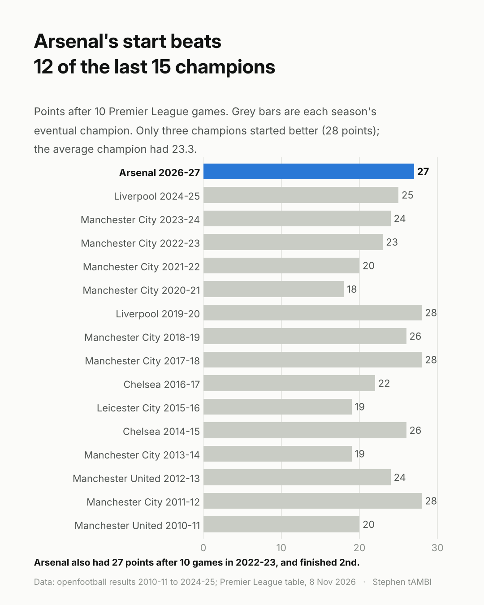
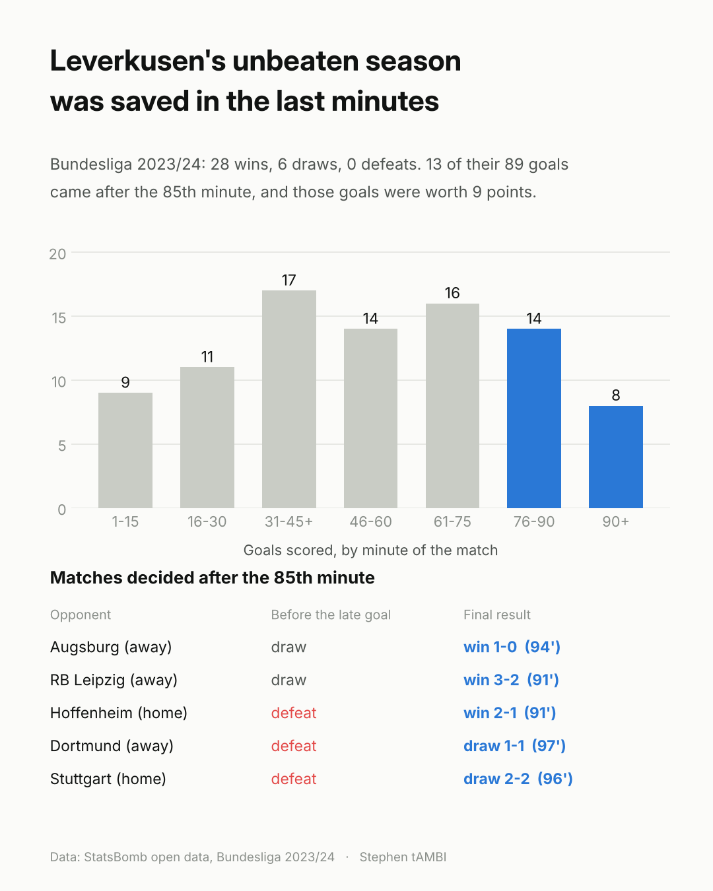
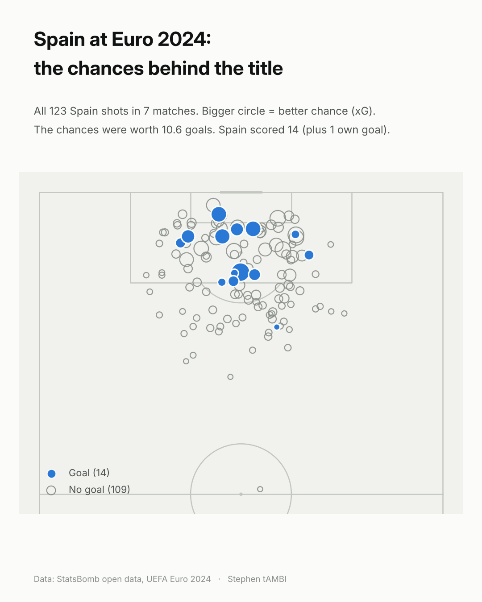
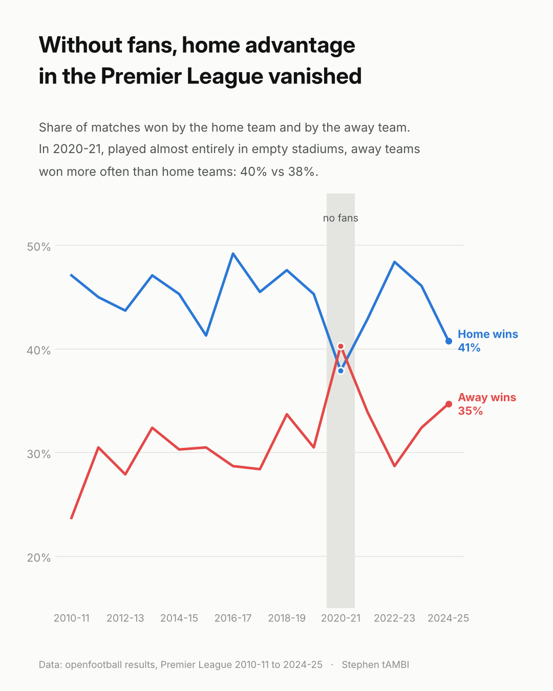
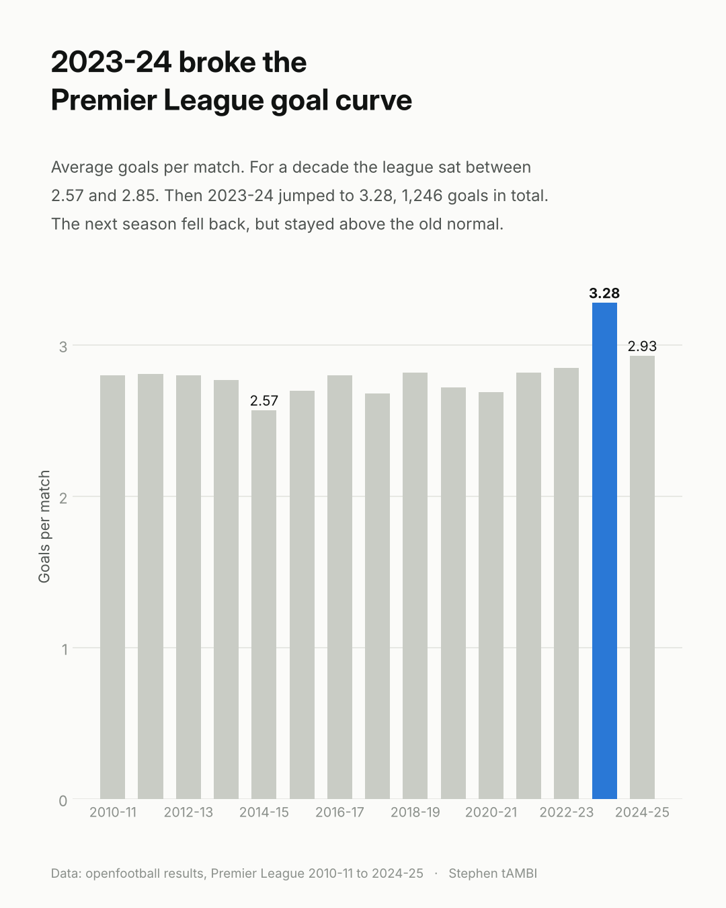
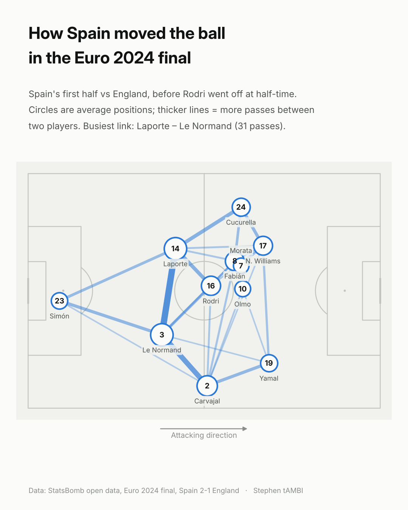

# Sports Analytics

By **Stephen tAMBI** · [Website](https://stambi292.github.io/sports-analytics/) · [LinkedIn](https://www.linkedin.com/in/stephen-tambi-1b4326317/)

**Live site: https://stambi292.github.io/sports-analytics/**

Sports analysed with data. Each sport has its own folder; football is the first.

# Football

Football analysed with data: title races, home advantage, late goals and passing networks. These analyses accompany my LinkedIn sports data series.

## Interactive pages
- **[The price of a title](https://stambi292.github.io/sports-analytics/football/price-of-a-title/)** – club wage bills (UEFA) vs final league positions in Europe's top five leagues, 2022/23–2024/25. Who paid more and still lost?
- **[Leverkusen 2023/24: Unbeaten, by the last minute](https://stambi292.github.io/sports-analytics/football/leverkusen/)** – switch the season to "stop every match at 85 minutes" and watch the unbeaten record disappear.
- **[Premier League by the numbers, 2010–2025](https://stambi292.github.io/sports-analytics/football/premier-league/)** – compare every champion's start, replay any title race, explore home advantage and goals per match.

## Charts
| | |
|---|---|
|  |  |
|  |  |
|  |  |

## Selected findings
- Leverkusen scored 13 of their 89 goals after the 85th minute in 2023/24. Those goals were worth 9 points and saved the unbeaten record.
- In 2020-21, played in empty stadiums, away teams won more Premier League matches than home teams (40% vs 38%).
- 2023-24 was the highest-scoring Premier League season in this data: 3.28 goals per match.

## Data
- UEFA, *The European Club Finance and Investment Landscape* (club wage rankings, financial years 2023–2025)
- [StatsBomb open data](https://github.com/statsbomb/open-data): event data for Bundesliga 2023/24 and Euro 2024
- [openfootball](https://github.com/openfootball/football.json): Premier League results 2010-11 to 2024-25. Matches from the 2020 restart are dated a year too early in the source; `football/scripts/epl_seasons.py` corrects this.

## Scripts
`football/scripts/` contains the Python code that cleans the data and draws the charts (pandas, matplotlib, mplsoccer), plus the HTML templates for the interactive pages. `football/data/` holds the processed data used by the interactive pages.
